<!-- ZEBRA_DESIGN_hero_START -->
<p><picture><source media="(max-width: 600px)" srcset="assets/readme/hero-mobile.svg"/>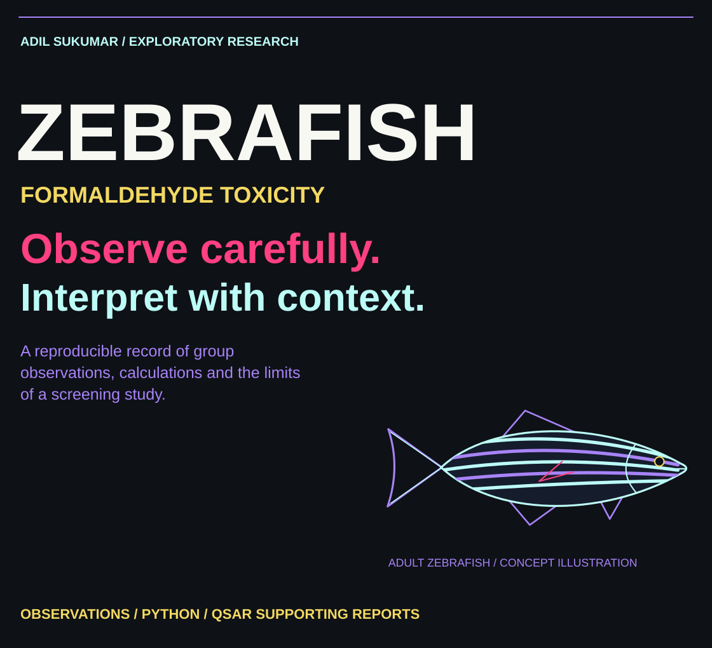</picture></p>
<!-- ZEBRA_DESIGN_hero_END -->

# Zebrafish Formaldehyde Toxicity Analysis

Reproducible analysis accompanying an exploratory adult-zebrafish formaldehyde screening report. This public edition keeps transcribed group observations, a small standard-library analysis script and tests; intermediate drafts, template downloads and report-layout experiments are omitted.

<!-- ZEBRA_DESIGN_observations_START -->
<p><picture><source media="(max-width: 600px)" srcset="assets/readme/section-observations-mobile.svg"/>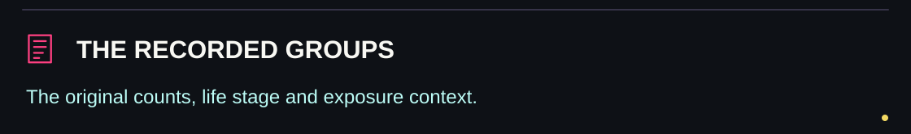</picture></p>
<!-- ZEBRA_DESIGN_observations_END -->

## Recorded observations

| Nominal concentration | Exposed | Deaths after 96 hours | Mortality |
|---|---:|---:|---:|
| Control | 10 | 1 | 10% |
| 40 ppm | 10 | 5 | 50% |
| 100 ppm | 10 | 10 | 100% |

There was one exposure vessel per group. `data/observations.csv` transcribes these recorded group counts; it is not individual-level raw tracking data. Life stage is adult, following the final report. Earlier working drafts used embryo wording and are not included here.

<!-- ZEBRA_DESIGN_reproduce_START -->
<p><picture><source media="(max-width: 600px)" srcset="assets/readme/section-reproduce-mobile.svg"/>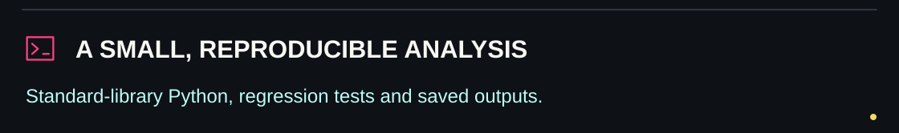</picture></p>

<p><picture><source media="(max-width: 600px)" srcset="assets/readme/analysis-mobile.svg"/>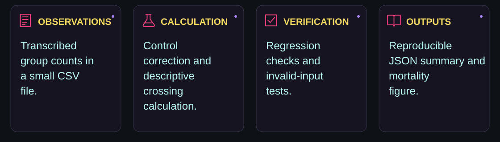</picture></p>
<!-- ZEBRA_DESIGN_reproduce_END -->

## Reproduce

Python 3.11 or newer; no third-party packages required:

```sh
python analyze.py
python -m unittest discover -s tests -v
```

`results/summary.json` records inputs, assumptions and outputs. `results/mortality.svg` plots the observed mortality. The [supporting OECD QSAR Toolbox reports](reports/qsar/README.md) include six original DOCX reports, searchable transcriptions and embedded tool depictions. They combine reported Toolbox profiling/database records with literature summaries. The unpublished experimental manuscript and intermediate drafts remain separate.

<!-- ZEBRA_DESIGN_method_START -->
<p><picture><source media="(max-width: 600px)" srcset="assets/readme/section-method-mobile.svg"/>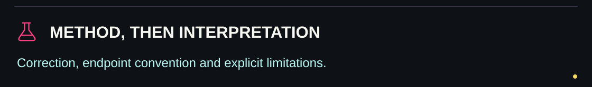</picture></p>

<p><picture><source media="(max-width: 600px)" srcset="assets/readme/context-mobile.svg"/>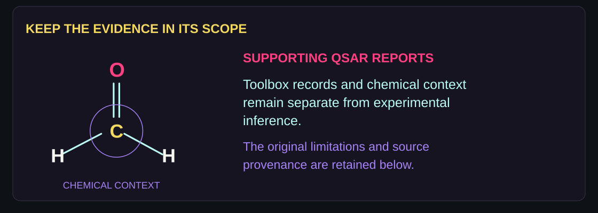</picture></p>
<!-- ZEBRA_DESIGN_method_END -->

## Method and interpretation

Abbott correction uses `(exposure mortality - control mortality) / (1 - control mortality)`, giving 44.44% at 40 nominal ppm. The report draws a straight line through two log10-concentration/probit points. Complete mortality is replaced with a finite 97.5% calculation endpoint; the resulting descriptive 50% crossing is approximately **42.51 nominal ppm**. Using 95% instead gives approximately **42.97 nominal ppm**.

This endpoint sensitivity is reported explicitly. Two nonzero concentration groups and no independent vessel replication do not establish a precise population LC50, a confidence interval, embryo sensitivity, or human-health risk. Nominal exposure concentrations were not analytically verified. QSAR structural alerts are chemical context, not confirmation of the mechanism of mortality.

<!-- ZEBRA_DESIGN_map_START -->
<p><picture><source media="(max-width: 600px)" srcset="assets/readme/section-map-mobile.svg"/>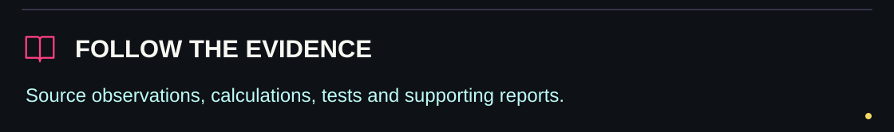</picture></p>

<p align="center"><a href="data/observations.csv">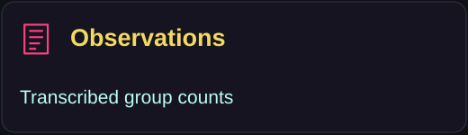</a> <a href="analyze.py">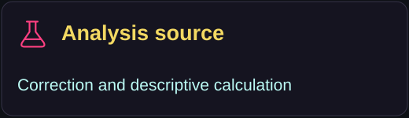</a> <a href="results/summary.json">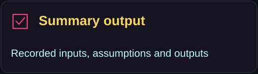</a> <a href="reports/qsar/README.md">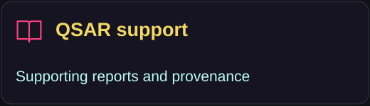</a></p>
<!-- ZEBRA_DESIGN_map_END -->

## Repository map

- `data/observations.csv`: transcribed observations.
- `analyze.py`: validation, correction and descriptive calculation.
- `tests/`: regression checks against the report and invalid inputs.
- `results/`: small, reproducible summary and figure.
- `reports/qsar/`: original supporting reports, chemical depictions, provenance and known source inconsistencies.

Project maintained by Adil Sukumar. Research authorship is as recorded in the original report. No publication, ethics-approval or independent replication claim is added by this repository.


<!-- ZEBRA_DESIGN_closing_START -->
<p><picture><source media="(max-width: 600px)" srcset="assets/readme/closing-mobile.svg"/>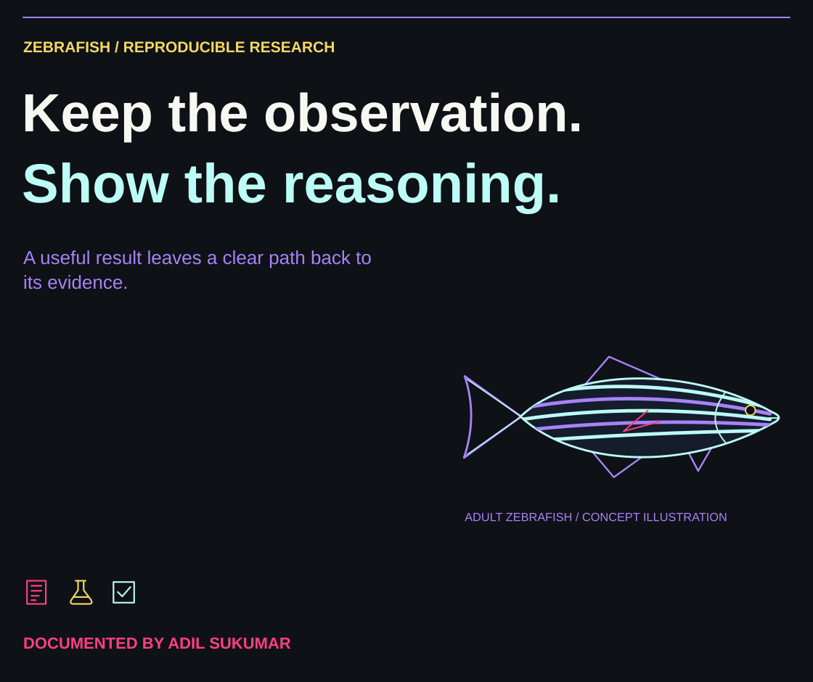</picture></p>
<!-- ZEBRA_DESIGN_closing_END -->
